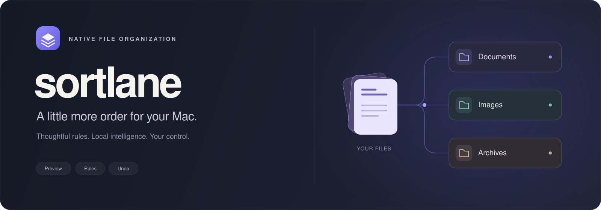

<p align="center">
  
</p>

<p align="center">
  <strong>A lightweight, native file organizer for macOS.</strong><br>
  Precise rules. A clear preview. Optional Apple Intelligence. Your files stay on your Mac.
</p>

<p align="center">
  <a href="#requirements"></a>
  <a href="#download"></a>
  <a href="Package.swift"></a>
  <a href="https://github.com/cattolatte/Sortlane/releases/tag/v0.2.1"></a>
  <a href="LICENSE"></a>
  <a href="https://github.com/cattolatte/Sortlane/actions/workflows/ci.yml"></a>
</p>

<p align="center">
  <a href="#download"><strong>Download for Mac</strong></a> ·
  <a href="docs/USER_GUIDE.md">User guide</a> ·
  <a href="CHANGELOG.md">Changelog</a> ·
  <a href="SECURITY.md">Security</a> ·
  <a href="CONTRIBUTING.md">Contribute</a>
</p>

## Make room for what matters

Turn a crowded Downloads folder into a plan you can review. Sortlane combines a native workspace with rules you control, local document suggestions, and a record of every move.

| | What you can do |
| --- | --- |
| **Preview & review** | Search, filter, and sort the queue. Inspect destinations and select files individually or in batches. |
| **Flexible rules** | Combine extensions, filename patterns, exclusions, sizes, and file ages. Use folders such as `Documents/{year}/{month}`. |
| **Local intelligence** | Find Receipts, Bills, Study, Work, and Personal documents with Apple Intelligence and Vision OCR. Review every suggestion. |
| **Folder routines** | Watch for new files while the app is open. Opt into automatic moves for eligible rule matches. |
| **Checked Undo** | Keep a local move journal. Restore files after identity and content checks. |
| **Native details** | Light and dark appearances, manual destinations, prioritized rules, and JSON import/export. |

No account or subscription. No external package dependencies. No bundled third-party model or network client entitlement.

## Download

**[Download v0.2.1 for Apple Silicon](https://github.com/cattolatte/Sortlane/releases/tag/v0.2.1)**

| Package | Best for |
| --- | --- |
| [**DMG disk image**](https://github.com/cattolatte/Sortlane/releases/download/v0.2.1/Sortlane-0.2.1-macos-arm64.dmg) | Open the disk image and copy `Sortlane.app` to Applications |
| [**tar.gz archive**](https://github.com/cattolatte/Sortlane/releases/download/v0.2.1/Sortlane-0.2.1-macos-arm64.tar.gz) | Extract the app bundle and move it to Applications |
| [**SHA256SUMS**](https://github.com/cattolatte/Sortlane/releases/download/v0.2.1/SHA256SUMS) | Verify the downloaded packages |

> **Preview signing:** v0.2.1 is ad-hoc signed, **not Developer ID signed or notarized**. macOS may block a downloaded copy. [Building locally](#build-and-test) is the supported alternative. Quit an older instance before replacing the app.

<details>
<summary>Verify a download</summary>

Put both packages and `SHA256SUMS` in the same folder, open Terminal there, and run:

```sh
shasum -a 256 -c SHA256SUMS
```

Checksums detect changed or incomplete downloads; they do not replace code signing or notarization. GitHub's automatically generated source archives contain source code, not an installed app.

</details>

## Requirements

| | Requirement |
| --- | --- |
| Mac | Apple Silicon |
| Operating system | macOS 26 or later |
| Document suggestions | Apple Intelligence available on the Mac; optional |
| File locations | Regular folders within your home directory, on the same volume |
| Building from source | Full Xcode 26 or later; verified locally with Xcode 27.2 |

The rules engine works when Apple Intelligence is unavailable. Apple's system model still uses system storage and compute; Sortlane does not download its own model.

## First run

1. Choose **Explore sample files** to try a contained demonstration, or select your source and destination folders.
2. Click **Scan folder**. Review the proposed destinations and any conflicts.
3. Optionally use **Refine** for local document suggestions, or inspect a file to choose its destination.
4. Select the files you want to move and click **Organize selected**.
5. Open **Activity → Undo** to restore an unchanged moved file.

Start with a dedicated inbox and a small set of files. Full Disk Access is not needed. See the [user guide](docs/USER_GUIDE.md) for rule examples, automation, and troubleshooting.

## Build and test

```sh
git clone https://github.com/cattolatte/Sortlane.git
cd Sortlane
open Sortlane.xcodeproj
```

Select the **Sortlane** scheme and **My Mac**, then run. The native app target uses App Sandbox and local ad-hoc signing.

Or build an optimized app bundle from Terminal:

```sh
bash scripts/build-app.sh release
open build/Sortlane.app
```

Run the core tests with:

```sh
swift test
```

The core test suite contains 38 tests for path restrictions, conflicts, stale previews, move/undo, journal recovery, rules, and review preservation. Fixtures live under `.build/SecurityFixtures`. Use the Xcode app target or packaged `.app` for normal use: running the raw Swift Package executable does not enable App Sandbox.

## Safety and current limits

Sortlane combines App Sandbox with its own path policy. It rejects system locations, the home root, Library, hidden folders, app libraries, symlinks, and detected source projects. Destinations stay inside the selected output folder. Moves never replace an existing file, and there is no delete feature.

This is early software, and the journal is not a backup. Cross-volume moves, multiple source profiles, duplicate detection, a login helper, and a Finder extension are not implemented. Cloud-only files are skipped. Broader sync-provider, accessibility, large-folder, and adversarial testing remain open work. Read [SECURITY.md](SECURITY.md) for the precise boundaries and limitations.

## Explore the project

| Guide | Inside |
| --- | --- |
| [User guide](docs/USER_GUIDE.md) | Setup, rule examples, local suggestions, automation, and recovery |
| [Architecture](docs/ARCHITECTURE.md) | Modules, execution flow, persistence, and platform frameworks |
| [Contributing](CONTRIBUTING.md) | Development workflow and reporting issues |
| [Changelog](CHANGELOG.md) | Changes by version |
| [Security](SECURITY.md) | Protections, threat model, and remaining hardening work |
| [Releasing](docs/RELEASING.md) | Release checks, packaging, and publication |

## License

Sortlane is available under the [MIT License](LICENSE).
